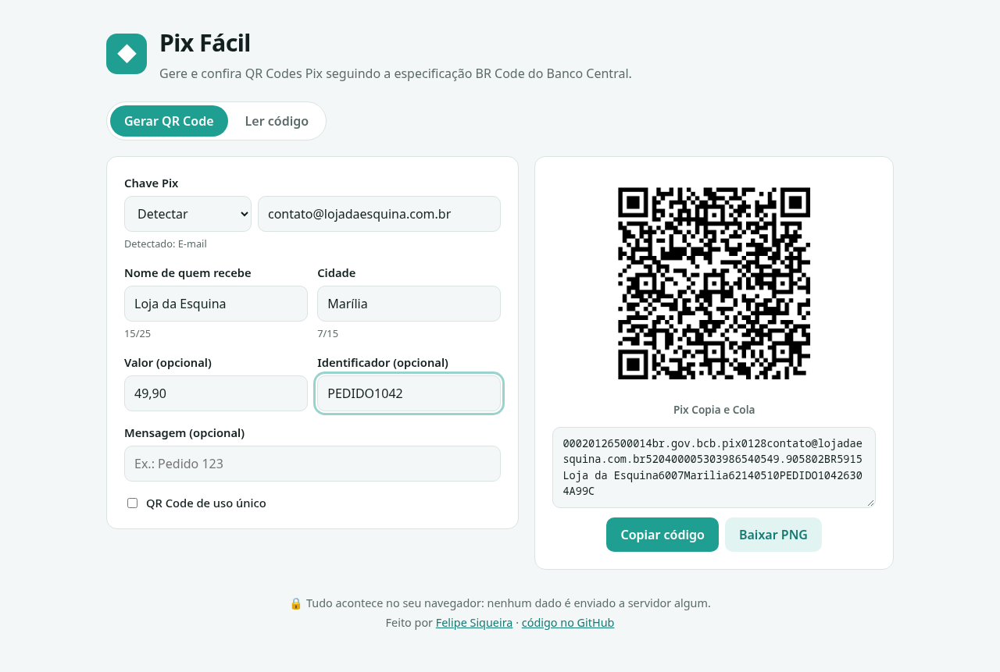
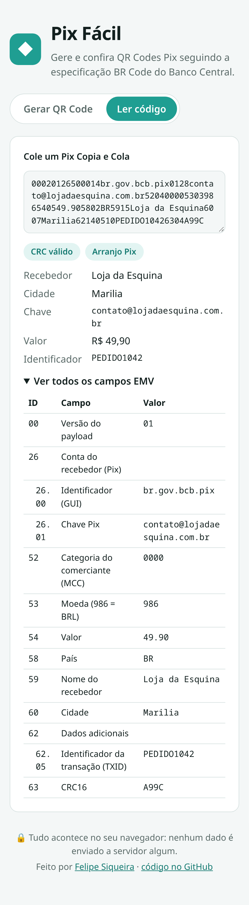
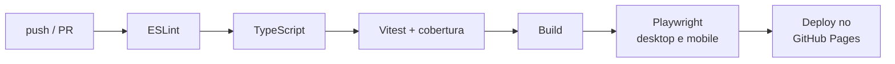

# Pix Fácil

[](https://github.com/fesqueira/pix-facil/actions/workflows/ci.yml)
[](https://github.com/fesqueira/pix-facil/actions/workflows/deploy.yml)
[](https://github.com/fesqueira/pix-facil/actions/workflows/codeql.yml)
[](LICENSE)

Gerador e leitor de **QR Code Pix (Copia e Cola)**, implementado do zero a partir da
especificação **BR Code** do Banco Central. Roda 100% no navegador: nenhum dado sai do
seu computador.

**👉 Demo ao vivo: [fesqueira.github.io/pix-facil](https://fesqueira.github.io/pix-facil/)**



## O que ele faz

- **Gera** o Pix Copia e Cola e o QR Code a partir da chave, nome, cidade e, se quiser,
  valor, identificador (TXID) e mensagem. O QR pode ser baixado em PNG.
- **Detecta e valida a chave**: CPF e CNPJ com dígitos verificadores, celular normalizado
  para `+55`, e-mail e chave aleatória (UUID).
- **Lê qualquer Pix Copia e Cola**: mostra recebedor, valor e chave, confere o CRC16 e
  abre a árvore completa de campos EMV, útil para depurar QR Codes que o banco recusa.
- Respeita os limites da especificação (nome com 25 caracteres, cidade com 15, conta do
  recebedor com 99) e remove acentos, como o manual recomenda.



## Por dentro

O núcleo fica em [`src/lib/pix`](src/lib/pix), sem dependências e separado da interface:

| Módulo | Responsabilidade |
| --- | --- |
| [`emv.ts`](src/lib/pix/emv.ts) | Codifica e lê o formato TLV (ID + tamanho + valor) do padrão EMV MPM |
| [`crc16.ts`](src/lib/pix/crc16.ts) | CRC-16/CCITT-FALSE (polinômio `0x1021`, início `0xFFFF`), exigido no campo 63 |
| [`keys.ts`](src/lib/pix/keys.ts) | Detecção, validação e normalização dos 5 tipos de chave Pix |
| [`payload.ts`](src/lib/pix/payload.ts) | Monta o payload estático na ordem do manual e faz o caminho inverso (parser) |

A corretude é verificada contra o **exemplo oficial do Manual de Padrões para Iniciação do
Pix**: o payload gerado bate byte a byte com o do manual, incluindo o CRC `1D3D`.

## Qualidade e automação

Cada push na `main` passa por uma esteira 100% automática no GitHub Actions:



- **Testes unitários e de componente** (Vitest + Testing Library): especificação, CRC,
  validação de chaves, limites e fluxo da interface.
- **Testes E2E** (Playwright) em Chrome desktop e em um celular emulado (Pixel 7).
- **Deploy contínuo**: o site só é publicado quando o CI da `main` passa.
- **CodeQL** analisa a segurança do código a cada push e toda semana.
- **Dependabot** abre PRs semanais de atualização de dependências e de Actions.

## Rodando localmente

Requer Node.js 22 ou mais novo.

```bash
git clone https://github.com/fesqueira/pix-facil.git
cd pix-facil
npm install
npm run dev          # http://localhost:5173
```

| Comando | O que faz |
| --- | --- |
| `npm test` | Testes unitários e de componente |
| `npm run coverage` | Testes com relatório de cobertura |
| `npm run test:e2e` | Testes E2E (rode `npx playwright install chromium` uma vez antes) |
| `npm run lint` / `npm run typecheck` | ESLint e checagem de tipos |
| `npm run build` | Build de produção em `dist/` |

## Stack

React 19 · TypeScript · Vite · Vitest · Testing Library · Playwright · GitHub Actions ·
GitHub Pages · [`qrcode`](https://github.com/soldair/node-qrcode) para desenhar o QR.

## Limites

Gera **Pix estático** (o mesmo tipo de QR que os bancos geram em "Receber"). Pix dinâmico,
com cobrança e vencimento, depende da API de um PSP e está fora do escopo.

---

Feito por **Felipe Siqueira**, desenvolvedor e fundador da [Simplifica Tech](https://github.com/fesqueira).
[LinkedIn](https://www.linkedin.com/in/felipe-rodrigues-siqueira-00694a369/) · [GitHub](https://github.com/fesqueira)

Licença [MIT](LICENSE).
